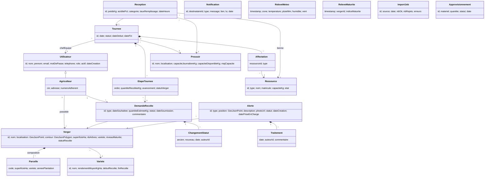

# OliveConnect — Architecture technique

## 1. Choix technologiques

| Couche | Technologie | Justification |
|---|---|---|
| Frontend | **Angular 20 (TypeScript, composants standalone, signals) + Tailwind CSS 4** | SPA structurée en couches comme l'API, responsive mobile-first |
| Formulaires | Angular Reactive Forms + validateurs | Nombreux formulaires courts avec validation côté client |
| Sécurité frontend | `HttpInterceptor` (JWT) + guards `canActivate` par rôle | Routes et appels protégés selon le profil |
| Carte | Leaflet + OpenStreetMap (`@bluehalo/ngx-leaflet`) | Gratuit, léger, GeoJSON natif |
| Calendrier | FullCalendar (`@fullcalendar/angular`, vue ressources) | Vue ressource × jour pour la logistique |
| Graphiques | `ng2-charts` (Chart.js) | KPIs du tableau de bord |
| Temps réel (client) | `@stomp/rx-stomp` (RxJS) | Notifications reçues sous forme d'Observables |
| Visite guidée | `driver.js` | Tour guidé à la 1re connexion |
| Tests frontend | Jasmine/Karma ou Jest (composants, services), Cypress (parcours) | Scénarios nominaux et alternatifs côté interface |
| Backend | Java 21, Spring Boot 3.x, Maven | Imposé (API web, couches, DI) |
| Persistance | **Spring Data MongoDB** | Repositories dérivés + `MongoTemplate` pour agrégations et requêtes géo |
| Base | **MongoDB 7** | Index 2dsphere (carte), pipeline d'agrégation (KPIs), collections time-series (relevés), schéma flexible |
| Sécurité | Spring Security + JWT (jjwt), BCrypt | Stateless, rôles par profil |
| Temps réel | WebSocket STOMP (spring-websocket) | Notifications push alertes / tournées |
| Imports | `@Scheduled` + Jackson / OpenCSV + Bean Validation | Chargement périodique avec contrôle de conformité |
| Logs | Log4j2 (rolling file) | Demandé dans l'énoncé |
| Tests | JUnit 5, Mockito, MockMvc, Testcontainers MongoDB | Scénarios nominaux et alternatifs |
| Documentation API | springdoc-openapi (Swagger UI) | Contrat de l'API visible et testable |
| Déploiement | Docker Compose, **Nginx** (reverse proxy + statique) | Imposé (Apache/Nginx/IIS) |
| Supervision | Spring Actuator + Prometheus + Grafana, Uptime | Disponibilité, CPU/RAM, logs, cache |
| Sauvegarde | `mongodump` via cron, rotation 7 jours | Sauvegarde régulière |

### Pourquoi MongoDB plutôt que Cassandra / Elasticsearch / Redis ?
- **Requêtes géospatiales natives** (`$near`, `$geoWithin`) indispensables pour la carte et la vérification des signalements.
- **Pipeline d'agrégation** pour calculer les KPIs directement côté base sur de gros volumes.
- **Documents imbriqués** adaptés aux agrégats métier (tournée + étapes, verger + parcelles).
- **Collections time-series** pour les relevés météo/maturité à fort volume.
- Cassandra impose des requêtes connues à l'avance (pas d'agrégations ad hoc) ; Redis est un cache, pas une base principale ;
  Elasticsearch est excellent en recherche mais faible en transactions/mises à jour fréquentes.

### Pourquoi Angular plutôt que React ?
- **Même organisation que l'API Spring** : services injectables (DI), composants, guards et intercepteurs. Le frontend
  reprend la séparation en couches du backend, ce qui renforce la cohérence évaluée (modèle ↔ API ↔ interface).
- **Outillage intégré** : routeur, client HTTP, Reactive Forms, validation et i18n sont fournis par le framework,
  sans assembler de librairies tierces. C'est adapté à une application de gestion riche en formulaires.
- **RxJS natif** pour le temps réel (STOMP) et la composition des appels HTTP.
- **Structure imposée** par l'Angular CLI : les 3 membres du groupe produisent un code homogène.
- **Tailwind CSS** pour une interface sobre et mobile-first (préfixes `sm:` `md:` `lg:`), directement traduite des maquettes.

### Organisation du frontend Angular
| Couche Angular | Rôle | Équivalent backend |
|---|---|---|
| Composant de page (`features/*/pages`) | Affichage, saisie, appel du service | Controller (côté client) |
| Service de domaine (`features/*/data`) | Appels HTTP typés, état local (signals) | Service |
| Modèles TypeScript (`core/models`) | Interfaces miroir des DTO Java | DTO |
| `core/auth` (guard + interceptor) | JWT, contrôle d'accès par rôle | Spring Security |
| `core/realtime` | Abonnement STOMP aux notifications | WebSocketConfig |

---

## 2. Architecture logique

```
┌──────────────────────────── Navigateur (mobile / PC) ────────────────────────────┐
│  Angular + Tailwind : pages par rôle · Leaflet · FullCalendar · Chart.js · STOMP │
└───────────────┬──────────────────────────────────────────────┬───────────────────┘
                │ HTTPS  /api/**  (JSON + JWT)                  │ WSS /ws (STOMP)
┌───────────────▼──────────────────────────────────────────────▼───────────────────┐
│                       Nginx (reverse proxy, gzip, cache statique)               │
└───────────────┬──────────────────────────────────────────────────────────────────┘
┌───────────────▼────────────────── Spring Boot API ───────────────────────────────┐
│  Security filter (JWT) → @RestController (DTO, validation)                       │
│        → @Service (règles de gestion, transitions d'état, notifications)         │
│        → Repository (Spring Data MongoDB / MongoTemplate)                        │
│        → @Document (Entity)                                                       │
│  Transverse : GlobalExceptionHandler · Mappers DTO · Scheduler d'import · Log4j2  │
└───────────────┬──────────────────────────────────────────────┬───────────────────┘
                │                                              │ lecture périodique
┌───────────────▼──────────┐                     ┌─────────────▼─────────────────────┐
│        MongoDB 7          │                     │ Sources simulées (JSON / CSV /    │
│ collections + index       │                     │ mock REST) : référentiels, météo, │
└───────────────────────────┘                     │ maturité, capacité pressoirs     │
                                                  └───────────────────────────────────┘
```

### Couches (par cas d'utilisation)
| Couche | Rôle | Exemple |
|---|---|---|
| Controller | Expose REST, valide les DTO, contrôle d'accès `@PreAuthorize` | `DemandeRecolteController` |
| Service | Règles de gestion RG01–RG10, transitions d'état, notifications | `DemandeRecolteService` |
| DAO / Repository | Accès données via Spring Data | `DemandeRecolteRepository extends MongoRepository` |
| Entity | Documents MongoDB annotés `@Document` | `DemandeRecolte` |

Injection de dépendances **par constructeur** (`@RequiredArgsConstructor` ou constructeur explicite).

---

## 3. Modèle de classes (Model)



---

## 4. Schéma NoSQL (MongoDB)

### 4.1 Règles de transformation Model → NoSQL
| # | Situation UML | Règle appliquée | Exemple |
|---|---|---|---|
| R1 | Classe entité indépendante | → une **collection** | `vergers`, `tournees` |
| R2 | Composition 1–peu, lue avec le parent, sans existence propre | → **sous-document imbriqué** (tableau) | `Verger.parcelles[]`, `Tournee.etapes[]`, `Alerte.traitements[]` |
| R3 | Association 1–N non bornée ou entité partagée | → **référence** par `ObjectId` côté « N » | `vergers.agriculteurId`, `demandes.vergerId` |
| R4 | Association N–N | → tableau de références dans le document le plus consulté | `Tournee.affectations[].ressourceId` |
| R5 | Héritage | → **une collection + discriminant** (`role` / `type`, `_class` Spring) | `utilisateurs` (Agriculteur), `ressources` (OUVRIER/TRACTEUR/BENNE/MATERIEL) |
| R6 | Champs lus très souvent avec une référence | → **dénormalisation** contrôlée (copie en lecture) | `demandes.vergerNom`, `tournees.etapes[].agriculteurNom` |
| R7 | Données horodatées massives | → **collection time-series** | `releves_meteo`, `releves_maturite` |
| R8 | Attribut géographique | → **GeoJSON** + index `2dsphere` | `vergers.localisation`, `alertes.position` |
| R9 | Énumération | → chaîne contrôlée (enum Java) | `statut`, `type` |
| R10 | Historique d'états | → tableau imbriqué borné (append-only) | `demandes.historique[]` |

### 4.2 Collections et exemples de documents

**utilisateurs**
```json
{ "_id": ObjectId, "nom": "Ben Salah", "prenom": "Ali", "email": "ali@mail.tn", "motDePasse": "$2a$10...",
  "telephone": "+216...", "role": "AGRICULTEUR", "actif": true,
  "agriculteur": { "cin": "0123...", "adresse": "Sakiet Ezzit", "numeroAdherent": "ADH-0042" } }
```

**vergers**
```json
{ "_id": ObjectId, "agriculteurId": ObjectId, "agriculteurNom": "Ali Ben Salah", "nom": "Verger Nord",
  "localisation": { "type": "Point", "coordinates": [10.76, 34.79] },
  "contour": { "type": "Polygon", "coordinates": [[...]] },
  "superficieHa": 4.5, "nbArbres": 380, "variete": "Chemlali", "niveauMaturite": 72, "statutRecolte": "MUR",
  "parcelles": [ { "code": "P1", "superficieHa": 2.0, "variete": "Chemlali", "anneePlantation": 1998 } ] }
```

**demandes_recolte**
```json
{ "_id": ObjectId, "agriculteurId": ObjectId, "vergerId": ObjectId, "vergerNom": "Verger Nord",
  "type": "URGENTE", "dateSouhaitee": ISODate, "quantiteEstimeeKg": 3500, "statut": "PLANIFIEE",
  "tourneeId": ObjectId, "dateSoumission": ISODate,
  "historique": [ { "ancien": "SOUMISE", "nouveau": "VALIDEE", "date": ISODate, "auteurId": ObjectId } ] }
```

**alertes**
```json
{ "_id": ObjectId, "auteurId": ObjectId, "vergerId": ObjectId, "type": "RAVAGEUR",
  "position": { "type": "Point", "coordinates": [10.761, 34.792] }, "description": "Mouche de l'olive",
  "photoUrl": "/uploads/a1.jpg", "statut": "PRISE_EN_CHARGE", "dateCreation": ISODate,
  "traitements": [ { "date": ISODate, "auteurId": ObjectId, "commentaire": "Équipe envoyée" } ] }
```

**tournees**
```json
{ "_id": ObjectId, "date": ISODate("2026-12-02"), "statut": "EN_COURS",
  "chefEquipeId": ObjectId, "chefEquipeNom": "Karim T.", "pressoirId": ObjectId,
  "etapes": [ { "ordre": 1, "demandeId": ObjectId, "vergerId": ObjectId, "vergerNom": "Verger Nord",
                "quantiteEstimeeKg": 3500, "quantiteRecolteeKg": 2100, "avancement": 60, "statutVerger": "EN_RECOLTE" } ],
  "affectations": [ { "ressourceId": ObjectId, "type": "TRACTEUR", "libelle": "TR-03" },
                    { "ressourceId": ObjectId, "type": "BENNE", "libelle": "BN-12", "capaciteKg": 2000 } ],
  "dateDebut": ISODate, "dateFin": null }
```

**ressources** `{ _id, type: "BENNE", nom, matricule, capaciteKg, etat: "DISPONIBLE" }`
**pressoirs** `{ _id, nom, localisation: Point, capaciteJournaliereKg, capaciteDisponibleKg, majCapacite }`
**receptions** `{ _id, tourneeId, pressoirId, benneId, poidsKg, aciditePct, categorie, tauxRemplissage, dateHeure, vergerIds[] }`
**notifications** `{ _id, destinataireId, type, message, lien, lu, date }`
**varietes**, **approvisionnements**, **import_jobs**
**releves_meteo** (time-series, `timeField: timestamp`, `metaField: zone`)
**releves_maturite** (time-series, `timeField: timestamp`, `metaField: vergerId`)

### 4.3 Index (garantie < 10 s, cible < 1 s)
| Collection | Index | Requête servie |
|---|---|---|
| utilisateurs | `{ email: 1 }` unique | Login |
| vergers | `{ localisation: "2dsphere" }` | Carte (`$geoWithin` viewport), `$near` |
| vergers | `{ agriculteurId: 1 }` | « Mes vergers » |
| vergers | `{ statutRecolte: 1, variete: 1 }` | Filtres carte |
| vergers | `{ nom: "text" }` | Recherche |
| demandes_recolte | `{ agriculteurId: 1, statut: 1 }` | Suivi agriculteur |
| demandes_recolte | `{ statut: 1, type: -1, dateSouhaitee: 1 }` | File de planification (urgentes d'abord) |
| tournees | `{ date: 1, statut: 1 }` | Calendrier |
| tournees | `{ "affectations.ressourceId": 1, date: 1 }` | Détection de conflit RG04 |
| tournees | `{ chefEquipeId: 1, date: -1 }` | « Mes tournées » |
| alertes | `{ position: "2dsphere" }`, `{ statut: 1, dateCreation: -1 }` | Carte des alertes, file de traitement |
| receptions | `{ pressoirId: 1, dateHeure: -1 }`, `{ vergerIds: 1 }` | KPIs pressoir / rendement |
| notifications | `{ destinataireId: 1, lu: 1, date: -1 }` | Cloche de notifications |

**Partitionnement (sharding, justifié pour la montée en charge)** : clé `{ vergerId: "hashed" }` pour `releves_maturite`
et `receptions`, `{ zone: 1, timestamp: 1 }` pour `releves_meteo`. Non activé en démo (instance unique) mais documenté.

### 4.4 Exemple d'agrégation (KPI rendement par verger)
```js
db.receptions.aggregate([
  { $match: { dateHeure: { $gte: ISODate("2026-10-01") } } },
  { $unwind: "$vergerIds" },
  { $group: { _id: "$vergerIds", totalKg: { $sum: "$poidsKg" }, remplissage: { $avg: "$tauxRemplissage" } } },
  { $lookup: { from: "vergers", localField: "_id", foreignField: "_id", as: "v" } },
  { $unwind: "$v" },
  { $project: { verger: "$v.nom", rendementKgHa: { $divide: ["$totalKg", "$v.superficieHa"] }, remplissage: 1 } },
  { $sort: { rendementKgHa: -1 } }
])
```

---

## 5. API REST

Préfixe `/api`, JSON, JWT `Authorization: Bearer`. Erreurs normalisées `{ status, code, message, details }`.

| Méthode & chemin | Rôles | UC |
|---|---|---|
| `POST /auth/login` · `POST /auth/inscription` | public | UC04, UC03 |
| `GET /public/vergers?bbox=` · `GET /public/stats` | public | UC01, UC02 |
| `GET/POST/PUT/DELETE /vergers` (+ `/mes`) | AGRICULTEUR (les siens), RESP_COLLECTE, ADMIN | UC10 |
| `GET /vergers/carte?bbox=&statut=&variete=` | authentifiés | UC23 |
| `POST /demandes` · `GET /demandes/mes` | AGRICULTEUR | UC11, UC14 |
| `PUT /demandes/{id}` · `POST /demandes/{id}/annuler` | AGRICULTEUR (propriétaire) | UC12 |
| `GET /demandes?statut=` · `POST /demandes/{id}/valider` · `/rejeter` | RESP_COLLECTE | UC20 |
| `POST /alertes` · `GET /alertes/mes` | AGRICULTEUR | UC13 |
| `GET /alertes` · `POST /alertes/{id}/traiter` · `/resoudre` | RESP_COLLECTE | UC22 |
| `POST /tournees` · `GET /tournees?date=` | RESP_COLLECTE | UC21 |
| `GET /tournees/mes` · `POST /tournees/{id}/demarrer` · `PATCH /tournees/{id}/etapes/{ordre}` · `POST /tournees/{id}/livrer` | CHEF_EQUIPE | UC30–34 |
| `GET/POST/PUT/DELETE /ressources` · `GET /ressources/disponibles?date=` · `GET /ressources/calendrier?from=&to=` | RESP_LOGISTIQUE (écriture), RESP_COLLECTE (lecture) | UC40, UC41 |
| `GET/POST /approvisionnements` | RESP_LOGISTIQUE | UC42 |
| `POST /receptions` · `PUT /pressoirs/{id}/capacite` | RESP_PRESSOIR | UC50, UC51 |
| `GET /dashboard/kpis?from=&to=` | RESP_COLLECTE, RESP_PRESSOIR, ADMIN | UC23, UC52, UC64 |
| `GET /notifications` · `POST /notifications/{id}/lue` | authentifiés | UC05 |
| `GET/POST/PUT /admin/utilisateurs` · `POST /admin/utilisateurs/{id}/activer` | ADMIN | UC60, UC61 |
| `GET /admin/imports` · `POST /admin/imports/{source}/lancer` | ADMIN | UC63 |
| WebSocket `/ws` → `/user/queue/notifications`, `/topic/alertes`, `/topic/tournees` | authentifiés | temps réel |

---

## 6. Sécurité

- Mot de passe hashé **BCrypt** ; JWT signé HS256, durée 8 h (journée de récolte), refresh optionnel.
- `SecurityFilterChain` : `/api/public/**`, `/api/auth/**` publics ; le reste authentifié ; `@PreAuthorize("hasRole(...)")` par méthode.
- **Contrôle d'appartenance** (RG01) dans les services : `verger.agriculteurId == currentUser.id` sinon `AccessDeniedException` (403).
- CORS limité au domaine du frontend ; Nginx force HTTPS en production.

### Matrice des droits
| Ressource | VISIT. | AGRI | R.COLL | CHEF | R.LOG | R.PRESS | ADMIN |
|---|---|---|---|---|---|---|---|
| Carte publique | L | L | L | L | L | L | L |
| Vergers | – | CRUD (siens) | L/M | L | L | – | CRUD |
| Demandes | – | C/L/M/A (siennes) | L/Valider | L | L | – | L |
| Alertes | – | C/L (siennes) | L/Traiter | L | – | – | L |
| Tournées | – | L (les siennes via demandes) | CRUD | L/Maj (siennes) | L | L | L |
| Ressources | – | – | L | – | CRUD | – | CRUD |
| Réceptions / capacité | – | L (siennes) | L | – | – | CRUD | L |
| Tableau de bord | – | – | L | – | – | L | L |
| Comptes / imports | – | – | – | – | – | – | CRUD |

---

## 7. Import des données externes

```
sources/ (volume monté)            ImportScheduler (@Scheduled cron paramétrable)
 ├─ referentiels/*.json   ──►  Parser (Jackson / OpenCSV) ──► Validator (Bean Validation + règles métier)
 ├─ meteo/*.csv                         │ valides                         │ invalides
 ├─ maturite/*.csv                      ▼                                 ▼
 └─ pressoirs/*.json            upsert MongoDB (bulkWrite)        ImportJob.erreurs[] + log
                                        └──► fichier déplacé dans archive/ (idempotence)
```
- Référentiels : quotidien (02:00). Données dynamiques : toutes les 15 min (paramétrable par l'ADMIN).
- Un service REST mock (`/mock/meteo`) peut remplacer les fichiers pour la démo.
- Mise à jour de `vergers.niveauMaturite` à partir du dernier relevé → déclenche une alerte MATURITE automatique au-delà d'un seuil.

---

## 8. Déploiement et supervision

```
                Internet  ──►  :80/:443
┌───────────────────────── Serveur (VM Ubuntu / Docker Compose) ─────────────────────────┐
│ nginx  ── /           → frontend statique (build Angular)                              │
│        ── /api, /ws   → backend:8080                                                   │
│ backend (Spring Boot)  ── mongo:27017                                                  │
│ mongo (volume mongo-data)                                                              │
│ prometheus ── scrape backend:/actuator/prometheus, node-exporter                       │
│ grafana (:3000) — tableaux : disponibilité, CPU/RAM, requêtes HTTP, latence, JVM       │
│ backup (cron) — mongodump quotidien → /backups, rotation 7 jours                       │
└────────────────────────────────────────────────────────────────────────────────────────┘
```
- **Logs** : Log4j2 rolling (10 Mo × 10), logs Nginx avec logrotate.
- **Cache** : Nginx cache des assets statiques (1 an, fichiers hashés), gzip ; cache Spring (`@Cacheable`) sur variétés et carte publique.
- **Disponibilité** : `restart: unless-stopped`, health checks Docker sur `/actuator/health`.
- Documentation de déploiement : `deploy/README.md` (installation, variables d'environnement, création du 1er admin, restauration de sauvegarde).
