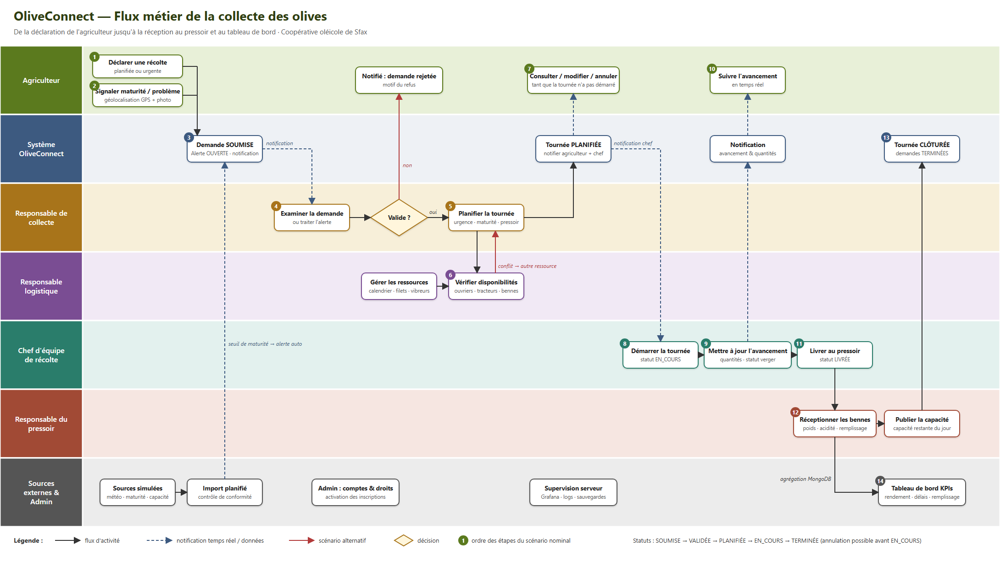

# OliveConnect — Dossier de conception (pré-code)

| Document | Contenu |
|---|---|
| [01-specification.md](01-specification.md) | Étude préalable, acteurs justifiés, cas d'utilisation (scénarios nominaux et alternatifs), machines à états, règles de gestion, exigences, KPIs |
| [02-architecture.md](02-architecture.md) | Choix techniques, architecture en couches, diagramme de classes, schéma MongoDB, règles de transformation, index, API REST, sécurité, imports, déploiement et supervision |
| [03-structure.md](03-structure.md) | Arborescence du dépôt (backend, frontend, deploy, data, docs) et conventions |
| [04-plan-de-travail.md](04-plan-de-travail.md) | Phases de réalisation, répartition entre les 3 étudiants, scénario de démonstration |
| [diagrams/flux-oliveconnect.png](diagrams/flux-oliveconnect.png) | Flux métier en couloirs par acteur (source SVG à côté) |
| [wireframes/wireframes.png](wireframes/wireframes.png) | 42 écrans (24 mobiles, 18 bureau) : toutes les pages, authentification comprise de toutes les interfaces, classées par acteur, avec un index (source HTML à côté) |

## Diagrammes UML (`diagrams/uml/`, PNG + SVG)

| Type | Fichiers |
|---|---|
| Cas d'utilisation | [uc-0-global](diagrams/uml/uc-0-global.png) · [uc-1-commun](diagrams/uml/uc-1-commun.png) · [uc-2-agriculteur](diagrams/uml/uc-2-agriculteur.png) · [uc-3-collecte-terrain](diagrams/uml/uc-3-collecte-terrain.png) · [uc-4-logistique-pressoir-admin](diagrams/uml/uc-4-logistique-pressoir-admin.png) |
| Classes | [classes](diagrams/uml/classes.png) |
| Séquence (participants) | [seq-1-authentification](diagrams/uml/seq-1-authentification.png) · [seq-2-declarer-recolte](diagrams/uml/seq-2-declarer-recolte.png) · [seq-3-planifier-tournee](diagrams/uml/seq-3-planifier-tournee.png) · [seq-4-reception-pressoir](diagrams/uml/seq-4-reception-pressoir.png) · [seq-5-import-planifie](diagrams/uml/seq-5-import-planifie.png) |

Les sources des diagrammes sont dans `diagrams/src/` : scripts Python qui génèrent les SVG, puis `render.sh` qui les exporte en PNG avec Chrome headless.
